# Open Media Explorer

[](https://github.com/aivrar/Open-Media-Explorer/releases/latest)


**Explore the world's open media from one portable Windows app.** World Media
brings together internet radio, live television, podcasts, public-domain films,
space media, cultural archives, audiobooks, conference recordings, PeerTube,
and independent Owncast streams from ten public sources.

Search everything, save favorites, browse a live-channel Grid, spin the Tuner,
discover something unexpected, watch the Visualizer move with the sound, shape
playback with a ten-band EQ, download finite media, and optionally record live
streams. No account, subscription, API key, or telemetry.

**New in v0.1.17:** adjust the picture and fit for video and TV, export the
current Favorites or My Playlists view, edit stream addresses with backups,
and see what your radio Favorites are playing. Internet Archive tracks and
LibriVox chapters play in order and resume where you stopped. Assign an EQ
curve to several stations, change the Now Playing blur and hide tabs you
rarely use. The Visualizer dissolves between scenes in time with the music,
and low-bitrate live streams start sooner. Thanks to TaxicabMessiah for
the ideas and reports.
[Discussion #8](https://github.com/aivrar/Open-Media-Explorer/discussions/8) ·
[Issue #6](https://github.com/aivrar/Open-Media-Explorer/issues/6)

**New in v0.1.16:** a station's stream format and bitrate now show for stations
from any source once they have played, not only for those Radio Browser lists:
the app remembers what the station's own stream said and shows it in the
station's tooltip ("Stream: AAC+ · 320 kbps"), in its details and, with **Show
technical source details** on, on its card. Some live AAC stations on Shoutcast
servers failed to start about one time in five or six; such a stream now starts
at its first whole sound frame. The volume slider is replaced by a compact
control (up, a number, down), and the player bar is one row, 74 px high where it
was 96. The mouse wheel over the Tuner's station cards moves one station, and a
**Visualizer:** control at the right of the Tuner's top bar sets how strongly the
Visualizer shows behind the Tuner. Starting the app again while it runs brings
its open window to the front instead of opening a second one. The missing
stream details were reported in
[issue #6](https://github.com/aivrar/Open-Media-Explorer/issues/6).

**New in v0.1.15:** channels, stations and episodes load faster and keep
loading through a poor connection: Radio Browser stations arrive 300 at a time,
lists are sent compressed, a server with a dead or slow address no longer holds
things up, and sources that failed are asked again by themselves when the
connection comes back. Podcast episodes published as M4A, Ogg, Opus, FLAC, WAV
or WebM are now listed and play, and so are more media.ccc.de, Wikimedia
Commons and Internet Archive recordings. Owncast and the media.ccc.de live
rooms are listed from the start, whichever Library view is open.

**New in v0.1.14:** stations on an old Shoutcast server, which did not play
although their address worked in a browser, now play, with their song titles.
Reported in [issue #6](https://github.com/aivrar/Open-Media-Explorer/issues/6).

**New in v0.1.13:** a **Now Playing** tab shows the station, the song and the
stream details large, over a blurred copy of its picture, with a large sound
meter. Live radio and TV no longer show a seek bar, the song on the player bar
is larger, a small red **!** marks a station that did not play last time, and
a station can get a picture from a file or by dropping one on its card. The
Visualizer has 103 scenes, three new overlays, two new blends and an **Extra
glow** switch, and can be shown faintly behind the Tuner. Dragging Favorites
into order is fixed. Reported in
[issue #6](https://github.com/aivrar/Open-Media-Explorer/issues/6)
and requested in [discussion #8](https://github.com/aivrar/Open-Media-Explorer/discussions/8).

**New in v0.1.12:** star the songs you like, give a station a name of your
own, drag Favorites into order, import `.json` and `.csv` playlists, and let
the app pick a station's best stream. A **Processor use** setting lets the
Visualizer use more of the computer, and the Visualizer now has 99 scenes, a
Strobe overlay and a side panel that folds into clear sections. A live
station whose connection closes now reconnects. Reported in
[issue #6](https://github.com/aivrar/Open-Media-Explorer/issues/6)
and requested in [discussion #8](https://github.com/aivrar/Open-Media-Explorer/discussions/8).

**New in v0.1.11:** a **Visualizer** tab shows pictures that move with the
sound of what is playing (71 scenes, effects, overlays and a shuffle). It shows
moving, flashing pictures, so a photosensitivity notice comes first. Importing
a playlist starts on **Add as: Auto**, which works out radio or TV by itself,
and Favorites get **Move to bottom** and **Remove all favorites**. Reported in
[issue #6](https://github.com/aivrar/Open-Media-Explorer/issues/6)
and requested in [discussion #8](https://github.com/aivrar/Open-Media-Explorer/discussions/8).

**New in v0.1.10:** a small sound meter in the player bar shows that a station
is really playing, the Tuner's station cards come in three sizes (Medium and
Large show station pictures), and the knob shows only the station's name.
Fixes: your own station pictures are no longer cut off, and the Tuner dial
keeps its size. Reported in [issue #6](https://github.com/aivrar/Open-Media-Explorer/issues/6)
and requested in [discussion #8](https://github.com/aivrar/Open-Media-Explorer/discussions/8).

**New in v0.1.9:** sort Favorites by hand or A-Z and group them in categories,
import `.pls` and `.xspf` playlists, see the song a radio station plays (with a
song log), use your own station pictures, and back up your data with one
button. Live streams reconnect by themselves. Library of Congress is gone (its
site refuses apps). Requested in [discussion #8](https://github.com/aivrar/Open-Media-Explorer/discussions/8).

**New in v0.1.8:** Tuner dial fixes. A dial with one station stays put, the
knob always rests at the same angle for the same station, the dial is no longer
cut off in a short window, and playing items without artwork show initials in
the player bar.

**New in v0.1.7:** drop an `.m3u` playlist file anywhere on the window to
import it, radio stations that stream without a picture no longer open an empty
video square, and the Tuner keeps the current station in view under the dial.

**New in v0.1.6:** sources you switch off in Settings disappear from the
Library sidebar, the mouse wheel turns the Tuner dial, and the floating video
grows with the window and has a button for a larger size. The optional FFmpeg
install in Settings works again after its provider moved on GitHub.

**New in v0.1.5:** the portable ZIP opens its window again after being
extracted from a download (it failed to start in v0.1.2 to v0.1.4).

**New in v0.1.4:** your favorites come first. The Library opens on
**Favorites**, saved items use compact cards, and the Tuner can spin through
only your starred stations with **★ My favorites**. Tuner and Grid show stations
as each source answers, more station logos load, items without artwork show
their initials, and the source labels are simpler (a Settings switch brings the
technical details back).

[**Download the latest EXE**](https://github.com/aivrar/Open-Media-Explorer/releases/latest/download/WorldMediaWindows.exe)
· [Full documentation](docs/wiki/README.md)
· [Release history](https://github.com/aivrar/Open-Media-Explorer/releases)

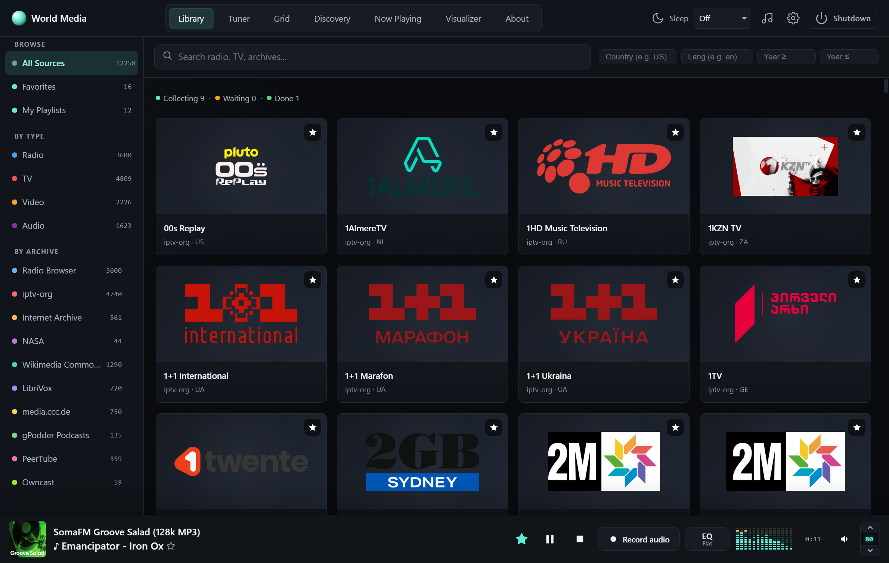

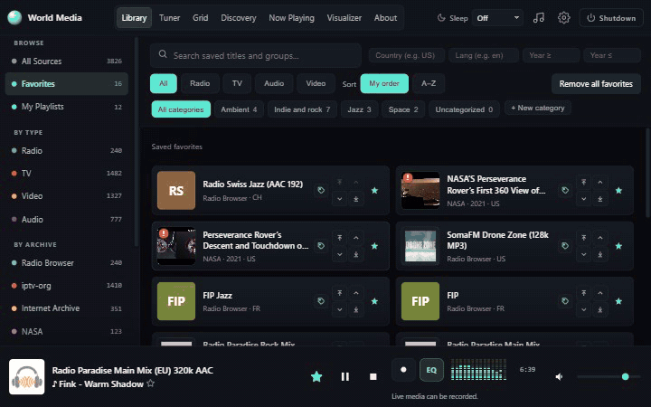

| Tune live radio and TV | Discover something unexpected |
|---|---|
| 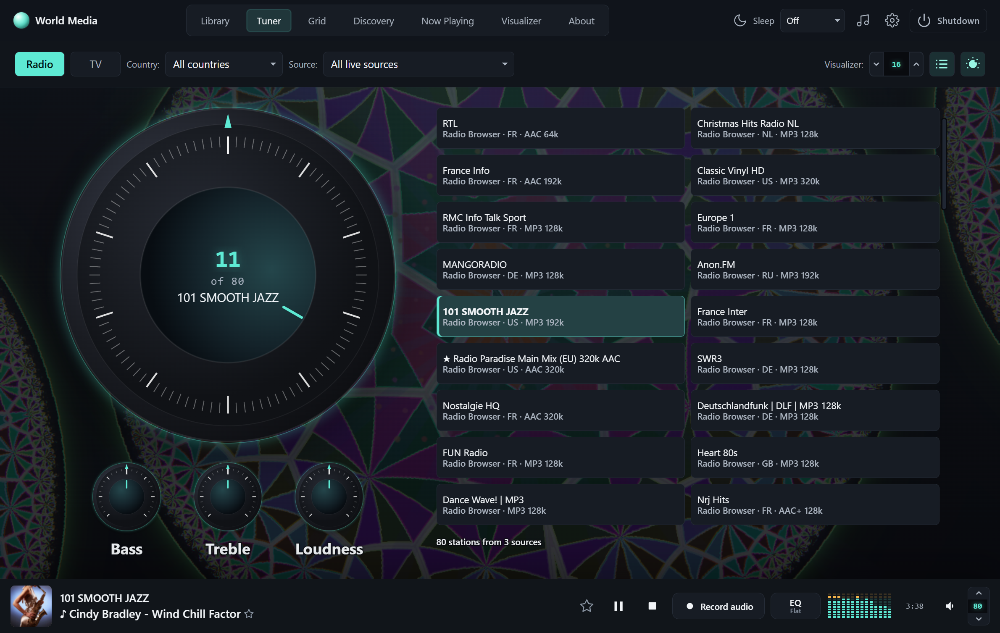 | 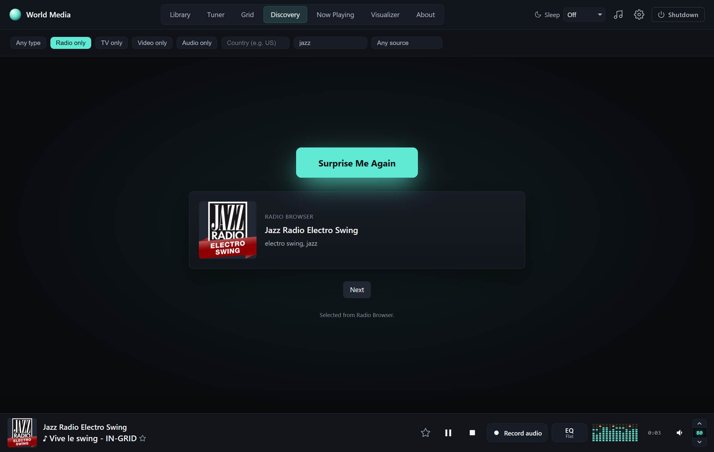 |

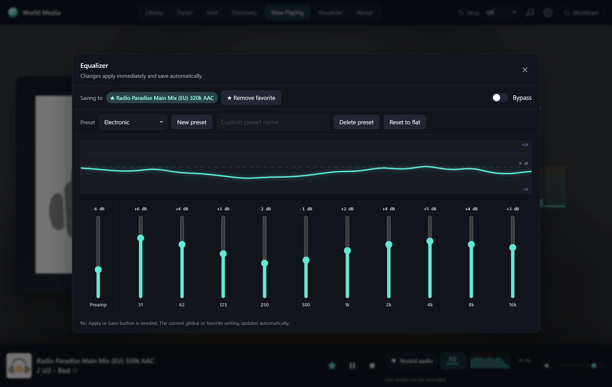

## Install

For the classic one-file Windows app, download and run:

```text
WorldMediaWindows.exe
```

The executable is unsigned and some heuristic antivirus products may require
the file or its containing folder to be explicitly allowed. The alternative
signed-runtime portable package is:

```text
WorldMediaWindows-0.1.17-portable.zip
```

For that package, extract the entire archive, keep its files together, and run
`WorldMediaWindows.exe` inside the `WorldMediaWindows` folder. Either form starts
a local server on `127.0.0.1`, opens a native WebView2
window, and stores its cache, favorites profile, settings, and logs beside the
launcher under:

```text
WorldMediaWindows-data\
```

An existing `%LOCALAPPDATA%\WorldMediaWindows\webview2_data` profile is copied
there once to preserve favorites; the legacy source is not deleted automatically.
The classic single EXE uses the Windows temporary directory only for its
transient startup extraction and cleans its `_MEI...` directory on normal
shutdown. Persistent app data always remains beside the EXE.

Only one copy runs per data folder. Starting the app again while it runs with
the same `WorldMediaWindows-data` folder brings the open window to the front
(restored if it was minimized) and does not open a second window. Copies with
different data folders, such as two portable folders, run side by side.

Users do not need Python, Node, Rust, Git, Docker, or WSL.

## Documentation

The full end-to-end user and developer wiki is in
[docs/wiki/README.md](docs/wiki/README.md), with a short index at
[docs/WIKI.md](docs/WIKI.md).

## What You Get

Seven tabs across the top: **Library**, **Tuner**, **Grid**, **Discovery**,
**Now Playing**, **Visualizer**, and **About**.

**Library** - search and browse everything. Left sidebar groups results by type
and source: Radio Browser, iptv-org, Internet Archive, NASA, Wikimedia Commons,
LibriVox, media.ccc.de/C3VOC, gPodder Podcasts, PeerTube, and Owncast.

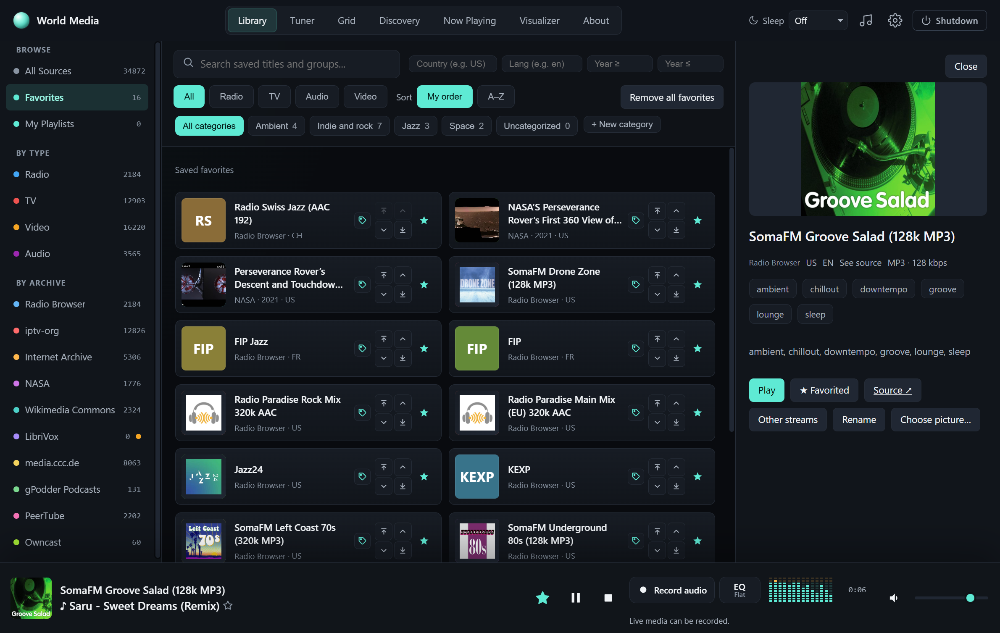

**Tuner** - a radio-style dial for live radio and live TV. Drag the dial,
scroll the mouse wheel over it or over the station cards under it (one station
per notch), or use arrow keys; the dial shows each station's place
in the list ("12 of 80"). Pick **★ My favorites**, or one of your own
categories, as the source to spin through only those stations, in the order of
your Favorites. **Settings > Appearance > Tuner card size** makes the station
cards under the dial Small, Medium or Large; Medium and Large show each
station's picture. The **Visualizer:** control at the right of the top bar (down,
a number, up) sets how strongly the Visualizer shows behind the Tuner when
**Settings > Appearance > Show the Visualizer behind the Tuner** is on: 0 turns
it off, and the default, 8, is a faint picture. The Tuner makes room under
the station strip for TV video and keeps the picture in place between channels.
Switch to Radio to bring the dial back to full size.

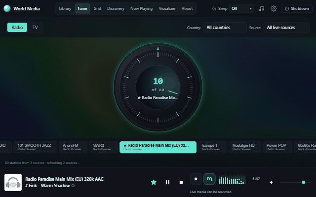

**Library detail panel** - click any item to see metadata, license, source, and
play it.

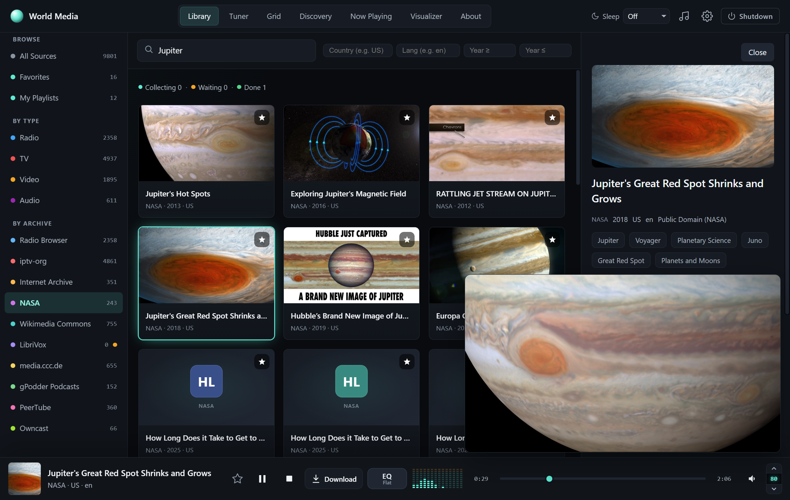

**Grid** - TV-guide-style tiles for live radio and live TV.

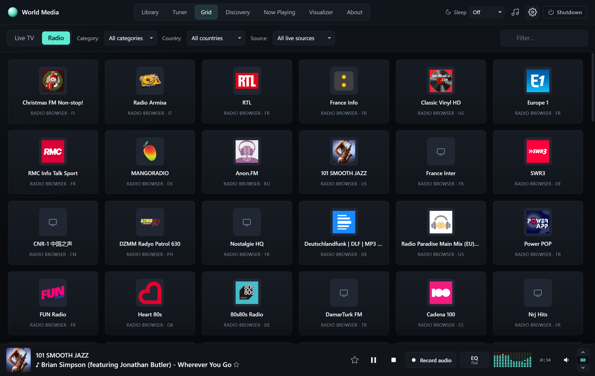

**Discovery** - random open media from the enabled sources.

**Now Playing** - whatever plays now, shown large: the station or item picture
over a blurred copy of it, its name, the song a radio station announces (with
a star and **Copy**), the stream details, how long it has played, and a large
sound meter. The meter turns red and reads **Muted** when muted. The **Format**
row also shows remembered details for playlist stations and HLS streams.

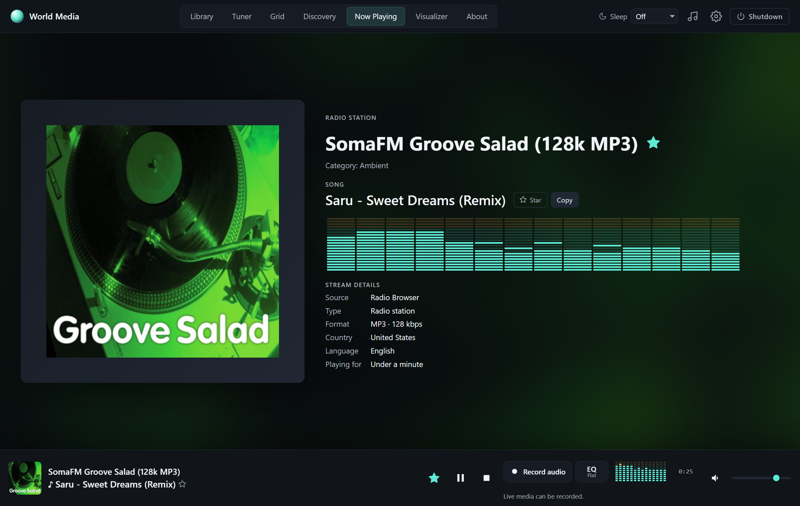

**Visualizer** - pictures that move with the sound of whatever is playing. It
has 103 scenes (flat patterns, 3D scenes, simulations and line drawings), a
**Look** choice for the scenes that have ready-made looks, a scene shuffle you
can limit to **Light only**, **Light and medium**, or all scenes (heavy too),
post effects and overlays (off until you turn them on), a slow drift in time
with the music, a star that keeps a scene with its effects and overlays, and a
quality, frame rate and brightness choice. Shuffle listens for builds, drops
and breaks, and scenes dissolve into one another. **Color travel** lets the
palette drift with the music. DIFS Tunnel Flight is brighter. Its side panel folds into sections
that say what is set. When the computer cannot keep up it lowers the load by
itself, and **Settings > Processor use** can let it use more of the processor
for a finer picture. It runs while its tab is open, or behind the Tuner if
you turn that setting on. It leaves the sound unchanged. It shows moving, flashing pictures: a notice about
photosensitivity comes before the first picture, and a flash limiter is always
on. See the
[Visualizer page](docs/wiki/09-visualizer.md).

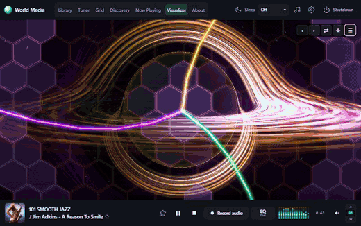

| | |
|---|---|
| 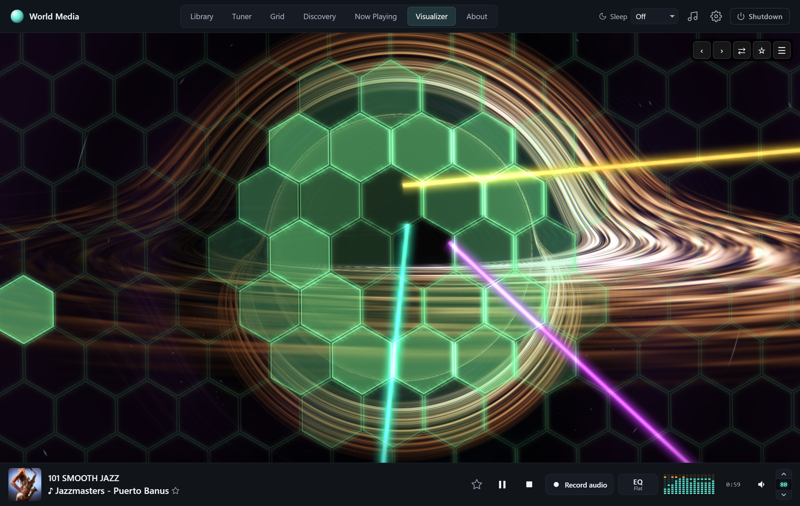 | 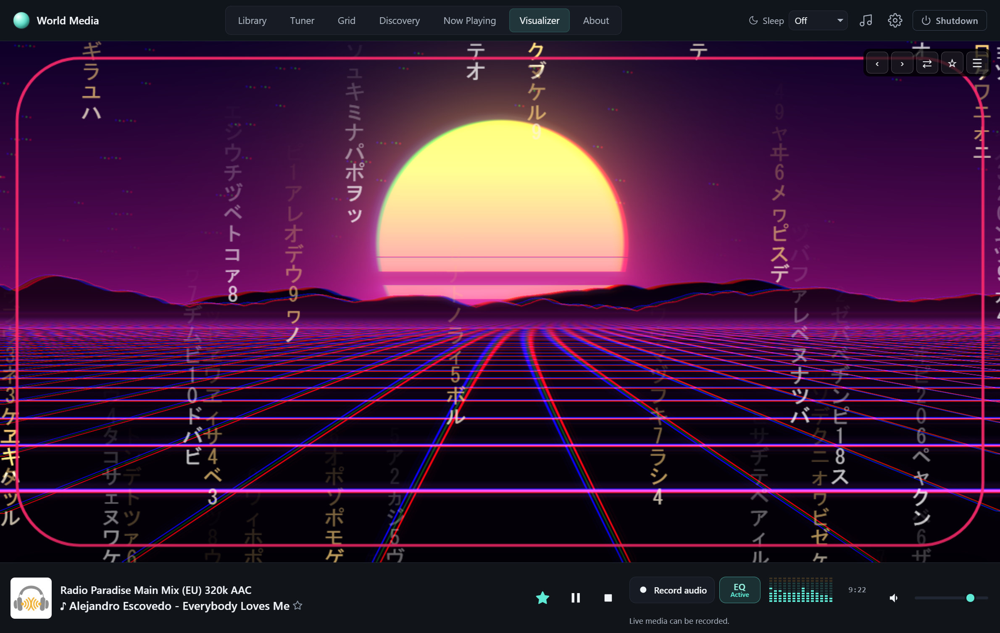 |
| 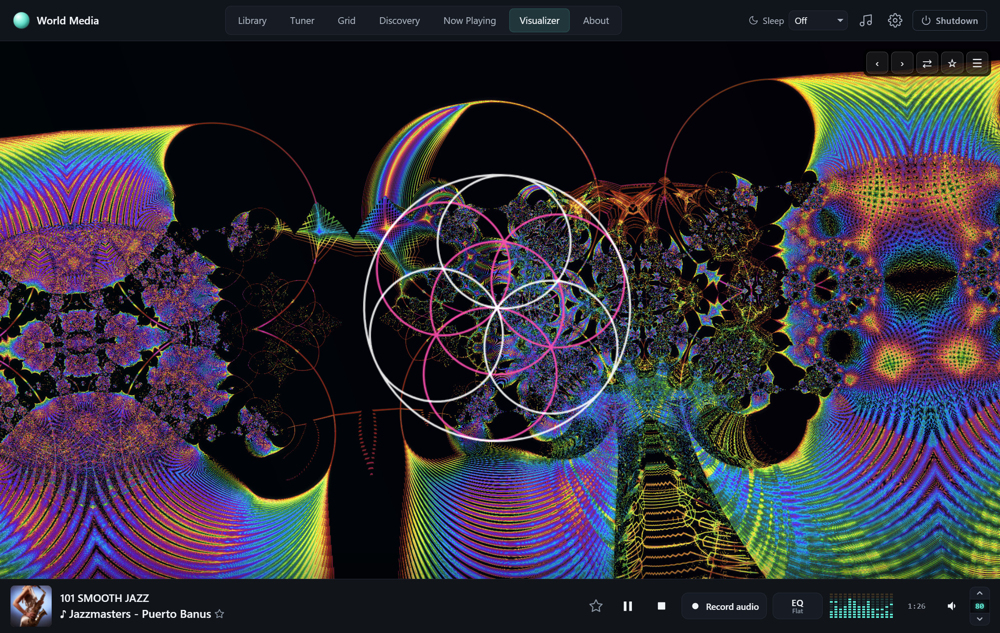 | 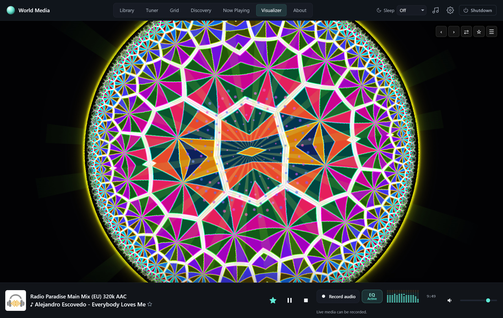 |
| 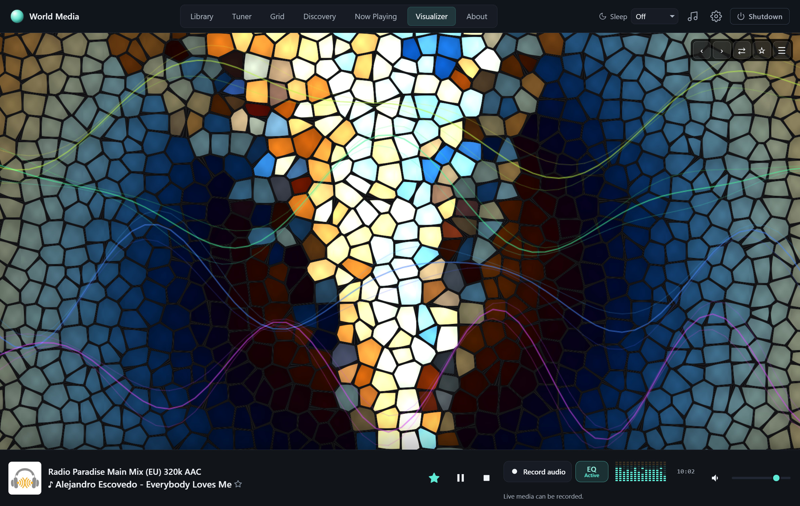 | 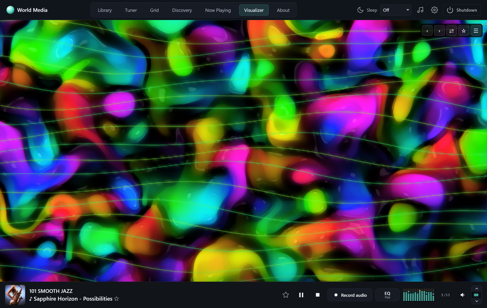 |
| 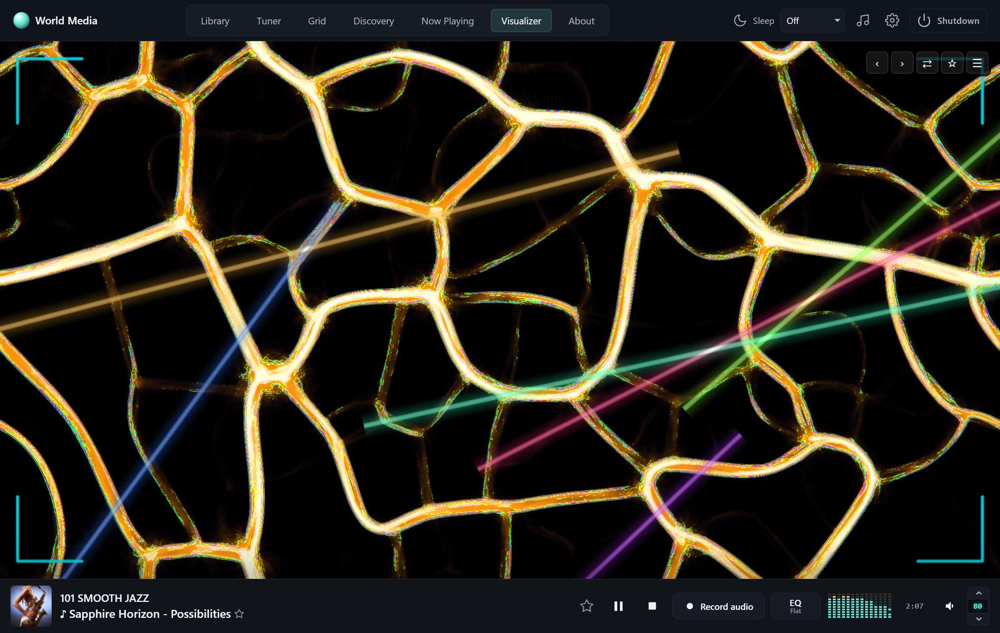 | 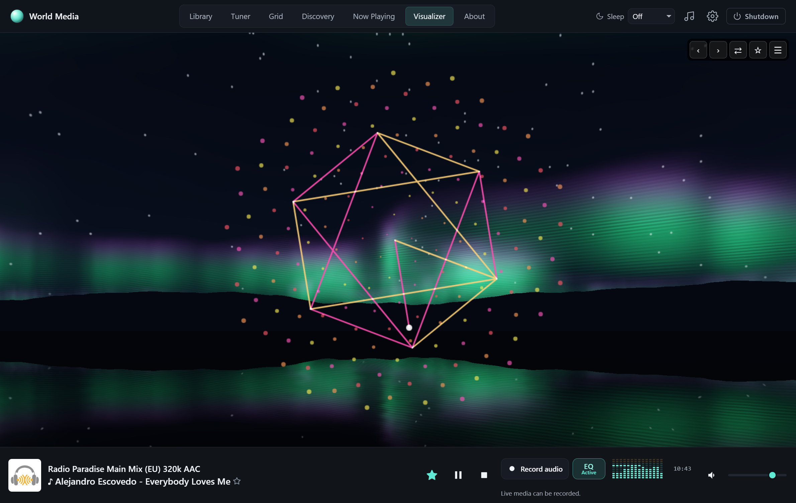 |

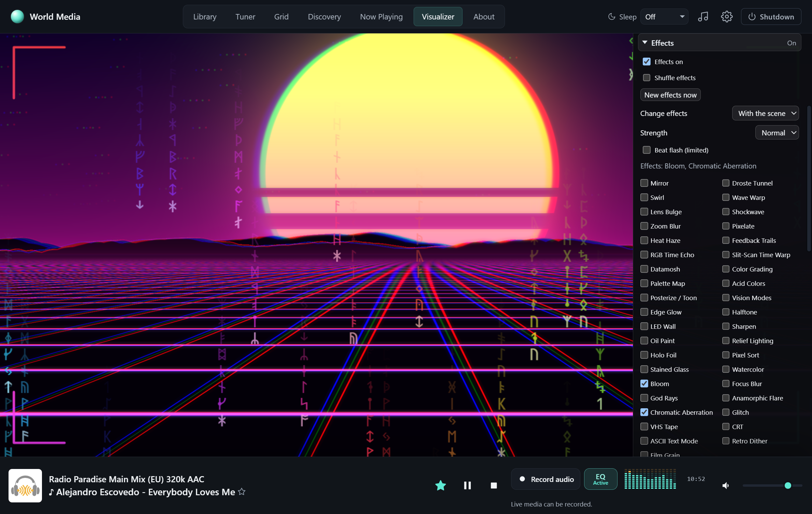

Library discovery collects concurrently from enabled sources, with independent
provider pacing and backoff. There is no fixed total-item cap. Only 300 cards
are mounted at a time to keep scrolling responsive; collected items are kept.
Compact sidebar statuses and hover details distinguish pulling, rate limits,
stale snapshots, and completed catalogs. Playback gets priority over background
collection and artwork; normal background priority returns when playback stops.

### Your own channels and organized Favorites

Open **Library → My Playlists → Add link**, paste a stream URL, optionally
name it, and press **Add**. Choose **Online playlist** for a channel-list
URL, or use **Import playlist** for a local `.m3u`, `.m3u8`, `.pls`, `.xspf`,
`.json` or `.csv` file. You can also drop
a local playlist file anywhere on the window. A direct HLS
`.m3u8` stream belongs under **Single channel**. These are Library collections,
not subscriptions: importing the same link again updates the saved list.
**Add as** (Auto, TV or Radio) gives a type to channels that do not say whether
they are radio or TV. Auto, the default, uses what most channels in the same
file say. When some channels needed a type from **Add as**, the result tells
you how many, and with Auto what it chose. To change or remove stations,
edit your own playlist file and import it again under the same file name, or
press **Remove playlist** to remove the list. Use **Stream address...** in a
saved station's details to change its HTTP or HTTPS address and add up to
five backups. World Media tries the backups in order if the main address
fails to start, and on reconnect.

In **Favorites** and **My Playlists**, use the **All / Radio / TV / Audio /
Video** buttons and local search to find saved channels. **Star all** in My
Playlists adds every listed channel to Favorites. Removing a playlist keeps its
favorites. **Export...** saves the items shown, using the selected type,
playlist or category, and search. Choose **M3U8** or **JSON**. The file goes
into Downloads and can be imported again with custom names and edited and
backup addresses. The message counts items skipped for lack of a stream
address. Each export creates a new file. Playlist URLs may contain access
tokens, so keep your data folder private.

Favorites can be sorted **My order** (drag a card before or after another, or
move it up, down, to the top or to the bottom with the buttons on it) or
**A-Z**. Use the tag button on a favorite card to put it in a category of your
own, such as "Rock" or "Talk", and the category buttons above the list to show
one category. **Rename** in a favorite's details gives it a name of your own;
**Use original name** brings the station's name back. **Remove all
favorites** asks first and says how many it will remove.

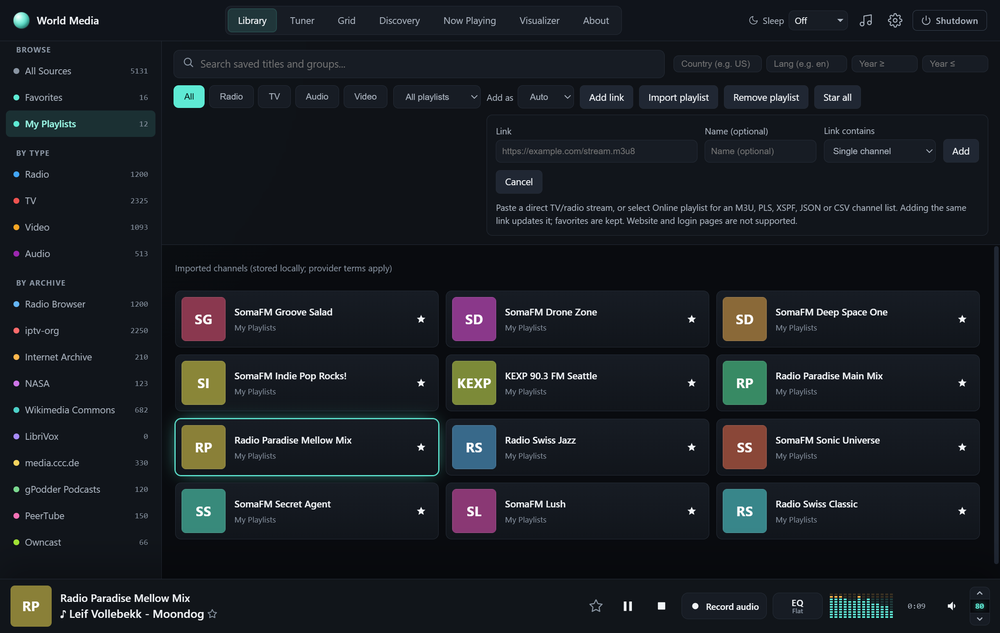

### Song titles, station pictures, and backup

Many radio stations announce the song they are playing. When a station does,
the title shows under the station name in the player bar, and the note button
at the top right opens a **Song log** of the songs you heard, which you can
copy or save as a CSV file. Star a song in the log, or the one playing now
with the star on the player bar, to keep it under **Starred songs**, where it
can be looked up on the web or on YouTube or saved as a text or CSV file. Not
every station sends titles, and stations delivered as HLS do not show one.
In **Favorites**, turn on **Show what's playing** to see the song on the first
line and performer on the second when a radio station sends both. Point at
the title for the station's original text. Titles refresh while Favorites is
open and the window is visible. The button is off by default.

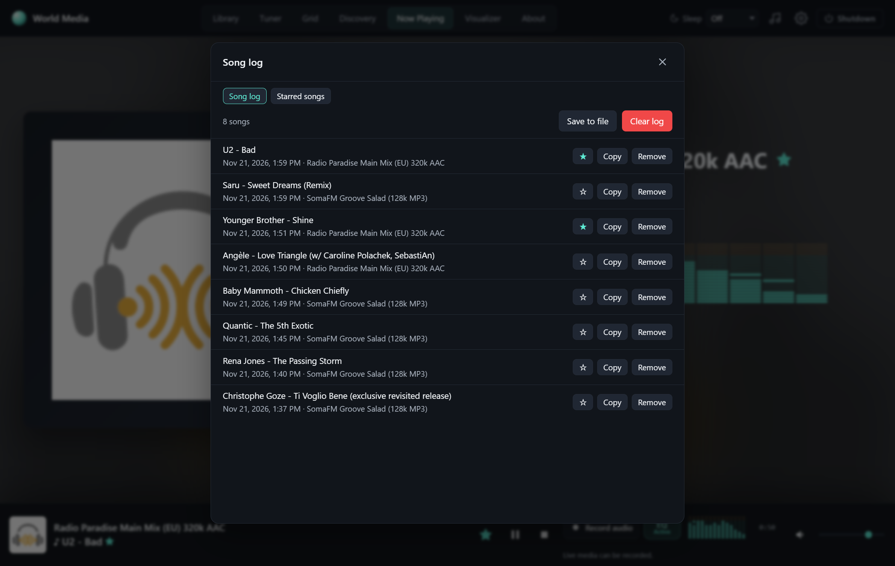

Put a picture named exactly like a station (PNG, JPG, WebP or GIF, up to 2 MB)
in the `station-images` folder (**Settings → Station images → Open folder**),
press **Refresh**, and it replaces that station's artwork, shown whole and
never cut off. A name Windows cannot use in a file, such as the "/" in
"AC/DC Radio", is written with `-`, `_`, a space or nothing in its place.
Settings lists the pictures that were not used and why. A station's format and
bitrate (for example "AAC+ · 320 kbps") show in its detail panel, in the tooltip
of its card in the Library and the Tuner, and on its card with **Show technical
source details** on. Radio Browser lists them for its stations; any other
station shows them once it has played, including HLS. Video can also show
resolution, frame rate and codec, for example "Stream: HLS · 1080p · 50 fps
· H.264 · 6.22 Mbps". **Clear local cache** removes remembered stream details. **Other streams** lists other listings of the same Radio Browser
station to pick from by hand.
**Settings > Content > Pick the best stream** tries a station's or channel's
best listed stream first. Its **Auto (verified)** choice also checks other
listings of a radio station in the background and switches to a better one
from the next start, only after two checks found it playing the same songs.

**Settings → Storage → Back up my data** writes one ZIP into the `downloads`
folder with your favorites and the names you gave them, settings, categories,
song log, starred songs, imported playlists, station pictures, saved video
picture settings and edited and backup stream addresses, plus `.m3u8` playlist
files that other players can open.
There is no restore button; the
[data guide](docs/wiki/05-data-cache-and-portability.md) says how to copy it
back. Playlist addresses can contain private links or account tokens, so share
the ZIP only with people you trust.

### Updating without losing data

Shut down the app, back up `WorldMediaWindows-data`, and replace only the EXE
for a single-file update. Keep the same adjacent data folder, downloads, and
tools. For ZIP updates, extract the new package separately and copy your backed-up
data, downloads, and tools beside its launcher. Never overwrite your profile
with a fresh test profile. See the [portability guide](docs/wiki/05-data-cache-and-portability.md).

## Appearance

Settings includes **System**, **Dark · Teal**, **Light**, **Midnight · Blue**,
**Forest · Green**, **Ember · Orange**, and **Amethyst · Violet**. Changes apply
immediately and persist across launches. System follows the Windows light/dark
preference. **Tabs shown** hides tabs you do not use. Library is always
visible. **Now Playing background blur** offers **Off**, **Light**, **Medium**
(the default) and **Strong**. Sources switched off in **Settings > Sources**
appear dimmed at the bottom of the Library sidebar. Turning a source back on
runs the current search for it again.

| Midnight · Blue | Forest · Green |
|---|---|
| 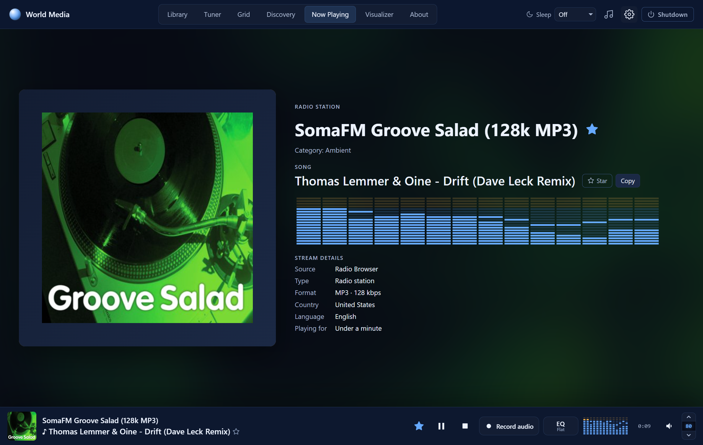 | 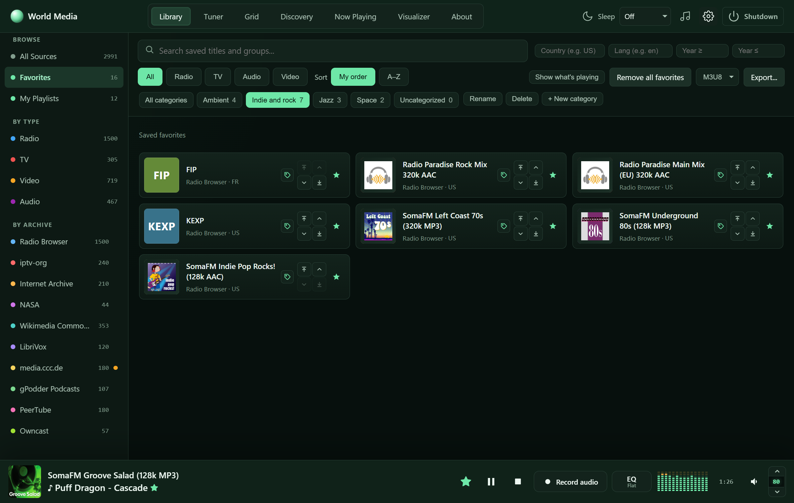 |

| Ember · Orange | Amethyst · Violet |
|---|---|
| 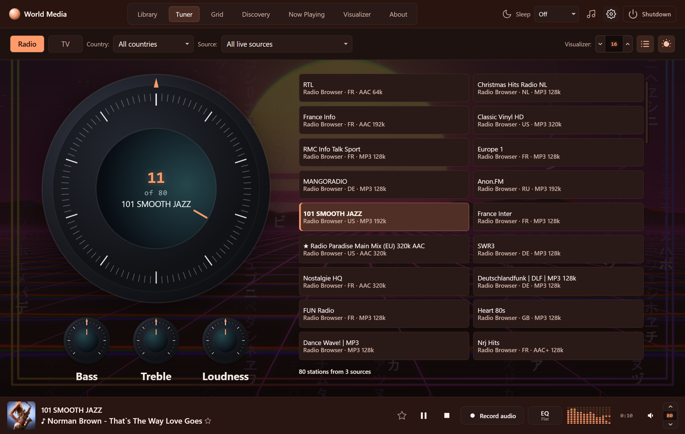 | 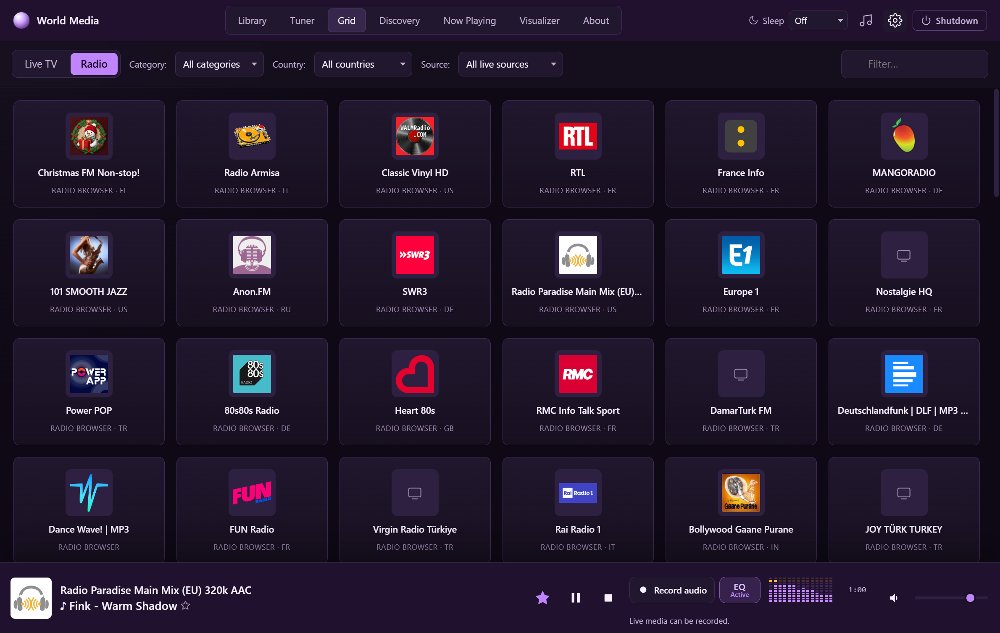 |

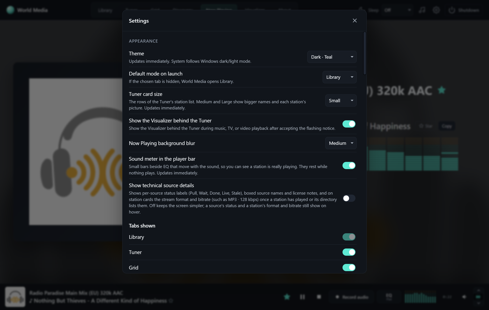

The native title bar follows the selected theme too. Windows 11 supports the
exact palette color; Windows 10 uses the matching dark or light caption style.

## Playback

Video plays in a movable overlay with fullscreen support. While the picture is
open, lists give you room to scroll to the last buttons. Open **Picture**
beside **EQ** to adjust **Brightness**, **Contrast**, **Saturation** and
**Hue**, or use **Reset**. **Fit** offers **Whole picture**, **Fill** and
**Zoom 110%**, **Zoom 125%** or **Zoom 133%** for black bars. It applies in
fullscreen too. Choose **For this channel** or **For all video**. Channel
settings stay saved while the channel is in Favorites or My Playlists. They
are included in backups and removed by **Clear local cache**. The picture
controls affect what you see. Recordings and downloads use the source stream.

Live TV hides the video's own timeline and time numbers. On-demand video
keeps them, and a live stream that turns out to be finite gets them back.
Live radio and TV that lose their connection reconnect by themselves for up
to ten minutes. The player bar says "Connection lost. Retrying..." meanwhile.

Internet Archive audio and LibriVox books with several parts play in order.
The player bar shows **Track N of M** or **Chapter N of M**, with **Previous
part** and **Next part**. Choose a part in the item's details and use
**Download** for that part. When you reopen an item with a saved position,
the player bar offers to resume at that position or **Start over**.

The player bar is one row in a window wider than 1000 px. The volume has its
own control beside the speaker (mute) button: an up button, the volume as a
number from 0 to 100, and a down button. A click changes the volume by 1, a held
button repeats, the mouse wheel over the control changes it by 2 per notch, and
with the control focused the arrow keys change it by 1 (Page Up and Page Down by
10, Home and End set 0 and 100). Changing the volume with a video's own controls
moves the number too. When the **Record** button is unavailable, point at it to
read why. **Record audio**, **Record video** and **Stop recording** take up
the same space. A capture's progress, result or error has room beside the
button, with the full status in its tooltip.

A small LED-style sound meter beside **EQ** moves with the sound, so you can see
that a station is really playing. It only reads the sound, rests while nothing
is heard, and can be switched off in **Settings > Appearance > Sound meter in
the player bar**.

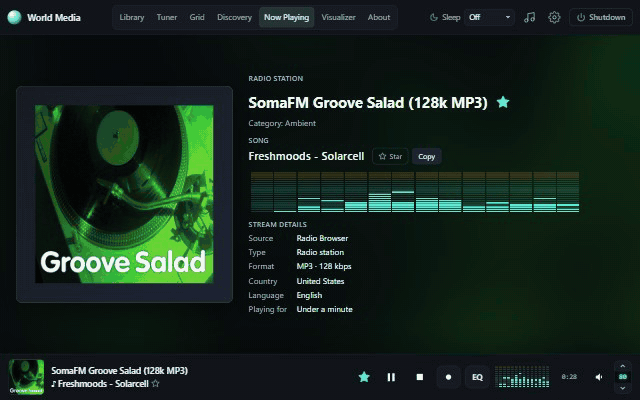

## Download, Record, And Equalize

- Finite originals expose **Download** and are written atomically to the
  `downloads` folder beside `WorldMediaWindows.exe`.
- Live radio and TV expose **Record**. Audio is finalized as MP3; video is
  finalized as H.264/AAC MP4. Recording reads the live source independently,
  so pausing, muting, changing volume, or adjusting EQ does not pause or alter
  the saved file. **Stop recording** performs finalization before publishing the
  completed filename.
- Settings provides Compact (96 kbps/480p), Balanced (160 kbps/720p), and High
  (256 kbps/1080p) profiles.
- The ten-band EQ and preamp apply immediately. A favorite can keep its own
  curve. Use **Stations...** to assign or clear a preset for several saved
  stations at once. To assign your current curve, first use **Save new preset**.
  In **Advanced**, set each band's Q from 0.25 to 8. Recordings made with EQ
  use those values.

Only download or record media when its source and your local law permit it.
World Media does not remove DRM or grant rights to third-party broadcasts.

## Where The Content Comes From

Every item World Media surfaces comes from one of ten public archives or
directories. The app does not host content and does not require API keys.

| Source | What it provides | Home | Licensing |
|---|---|---|---|
| [Radio Browser](https://www.radio-browser.info) | Internet radio stations | `radio-browser.info` | Stations retain their own broadcast rights |
| [iptv-org](https://iptv-org.github.io) | Free-to-air IPTV channels | `iptv-org.github.io` | Stream operators retain their own rights |
| [Internet Archive](https://archive.org) | Films, recordings, books, and other media | `archive.org` | Per item, often public domain or Creative Commons |
| [NASA Image and Video Library](https://images.nasa.gov) | Mission photos, videos, and audio | `images.nasa.gov` | Public domain for U.S. government work |
| [Wikimedia Commons](https://commons.wikimedia.org) | Free-licensed media files | `commons.wikimedia.org` | CC-BY-SA or public domain per file |
| [LibriVox](https://librivox.org) | Public-domain audiobooks | `librivox.org` | Public domain |
| [media.ccc.de](https://media.ccc.de) | Technical conference recordings and current C3VOC streams | `media.ccc.de` | Per recording or event |
| [gPodder](https://gpodder.net) | Open podcast directory resolved through publisher feeds | `gpodder.net` | Publisher terms per episode |
| [PeerTube](https://joinpeertube.org) | Federated on-demand and live video | Independent instances | Per video and instance |
| [Owncast](https://owncast.online) | Independent self-hosted live video | Independent servers | Broadcaster terms |

## Privacy And Runtime Model

- **No accounts.** Nothing to sign up for.
- **No telemetry.** The app does not collect usage data.
- **No API keys.** All ten sources use public anonymous endpoints.
- **Localhost only.** The bundled Python server binds to `127.0.0.1`.
- **Two bounded same-origin relays.** Catalog metadata uses an HTTPS-only,
  DNS-pinned allowlist proxy. Playback and capture use opaque expiring relay
  IDs, including rewritten HLS and DASH child resources. Upstream URLs and
  required playback headers are not exposed through control routes or logs.
- **No Linux child.** This build has no WSL distro, no rootfs image, no Docker
  image, and no setup script.

## Content Preference And Provider Limits

Explicit/NSFW content is off by default. It can be enabled only with the
**Show explicit/NSFW content** switch in Settings. Marked items are then shown
with a visible label; enabling the switch does not weaken URL, redirect,
private-network, schema, or media-safety checks. Turning it off hides marked
items everywhere while retaining saved favorites as nonrevealing placeholders.

Public catalogs are not equally reliable. A source may return a CAPTCHA or 429
even below its published limit; the app retains the cursor and backs off
instead of reporting a false zero. Podcast feeds and independent
PeerTube/Owncast servers may be dead, slow, or malformed; one failure is
isolated from the other sources. C3VOC and Owncast are live snapshots that
refresh, and an empty C3VOC snapshot between events is valid. A provider marked
**complete** has reached the end of the current finite catalog; live snapshots
continue on their own refresh schedule.

Library of Congress was removed from the app because its site (loc.gov) no
longer answers apps: every request now gets a browser check instead of data,
and World Media does not try to get around that. Items you saved from it stay
in Favorites and playlists.

The exact public endpoints, cache/refresh rules, and source-specific limits are
documented in [docs/PROVIDERS.md](docs/PROVIDERS.md).

## Troubleshooting

- If discovery says it is paused, scroll toward the bottom of the current
  results; fetching resumes automatically. Use **Load more** for an immediate
  user-priority request.
- **Retrying**, **rate limited**, or **stale** means the cursor and last verified
  data were preserved. **Retry now** is safe and does not create duplicate work.
- A playable item can still lack Download when the provider restricts it or
  exposes only a stream. Live media uses Record after a capable FFmpeg pair is
  detected or installed from Settings.
- An empty or broken independent stream is an upstream condition. **Try next**
  moves on without deleting the item or favorite.
- No song title under a station means the station does not send one (or is
  delivered as HLS). See the
  [troubleshooting guide](docs/wiki/06-troubleshooting.md).
- If a song title is cut short in its tooltip too, the station may have sent
  it that way.
- If a station starts slowly, give it a few seconds to connect. HLS can take
  longer. Try a backup address for a saved station if you have one.
- A favorite missing from the Tuner dial may be saved as the other type: the
  Tuner's status line says so. The same guide tells how to fix it.
- If the Visualizer is slow, set **Quality** to Low, **Frame rate** to 15 or 30,
  and choose Light scenes; effects and overlays are off by default, and
  **Settings > Processor use** starts at Low.
- Starting World Media again while it runs with the same data folder brings the
  open window to the front; it does not open a second one. A start made at the
  very moment that window is closing may open nothing: start it again.
- Runtime diagnostics are under `WorldMediaWindows-data\logs\` beside the
  launcher and do
  not contain upstream media URLs or authentication secrets.

## Requirements

- Windows 10 22H2 or Windows 11 (64-bit)
- Microsoft Edge WebView2 Runtime
- Internet access for upstream catalogs and streams

## Build From Source

```powershell
npm install
npm test
npm run build
python -m pip install --cache-dir .\build\local-cache\pip -r requirements-build.txt
python .\build_single_exe.py --skip-frontend
python .\build_windows.py --skip-frontend
```

The output is:

```text
dist\WorldMediaWindows.exe
dist\WorldMediaWindows\WorldMediaWindows.exe
dist\WorldMediaWindows-0.1.17-portable.zip
```

See [docs/BUILD_WINDOWS.md](docs/BUILD_WINDOWS.md) for the full build and smoke
test flow.

## License

MIT. See [LICENSE](LICENSE). Content from the listed sources retains its
original license.

### Bundled DASH playback library

MPEG-DASH playback uses [dash.js 5.2.0](https://github.com/Dash-Industry-Forum/dash.js),
bundled into the frontend under its
[BSD 3-Clause license](https://github.com/Dash-Industry-Forum/dash.js/blob/v5.2.0/LICENSE.md).
DRM-protected MPDs are rejected with an explicit unsupported response; World
Media does not request licenses or accept browser-provided license endpoints.

HLS playback uses vendored
[hls.js 1.5.13](https://github.com/video-dev/hls.js/tree/v1.5.13) under the
[Apache License 2.0](https://github.com/video-dev/hls.js/blob/v1.5.13/LICENSE).
The packaged app exposes its complete third-party notice at
`/THIRD_PARTY_NOTICES.txt` on its localhost runtime.

### Visualizer scenes

The Visualizer's scenes, effects and overlays are ported from
[Psychedelia Studio](https://github.com/aivrar/psychedelia-studio) (MIT, same
author). Some of its shader code is borrowed from others and keeps its own
license. It is credited under **Visualizer credits** on the About page, in
[CREDITS.md](CREDITS.md) and in `/THIRD_PARTY_NOTICES.txt`.

### Optional FFmpeg recording tool

World Media does not bundle FFmpeg in its EXE. Recording features can use an
existing capable `ffmpeg`/`ffprobe` pair or, after explicit confirmation, install
the exact `ffmpeg-n8.1-latest-win64-gpl-8.1.zip` asset from
[FFmpeg-Builds/FFmpeg-Builds](https://github.com/FFmpeg-Builds/FFmpeg-Builds). The managed archive
is downloaded without administrator access, checked against GitHub's SHA-256
digest, inspected before extraction, capability-probed in staging, and only then
selected atomically. Its license files, install manifest, and `SOURCE.txt` are
retained beside the managed binaries. FFmpeg licensing details are available at
[ffmpeg.org/legal.html](https://ffmpeg.org/legal.html).

The normal unit suite uses small local fixtures. The full current-provider smoke
is intentionally opt-in because it downloads more than 160 MB:

```powershell
$env:WORLDMEDIA_FFMPEG_INTEGRATION = "1"
python .\tests_python\ffmpeg_real_integration.py
Remove-Item Env:WORLDMEDIA_FFMPEG_INTEGRATION
```
